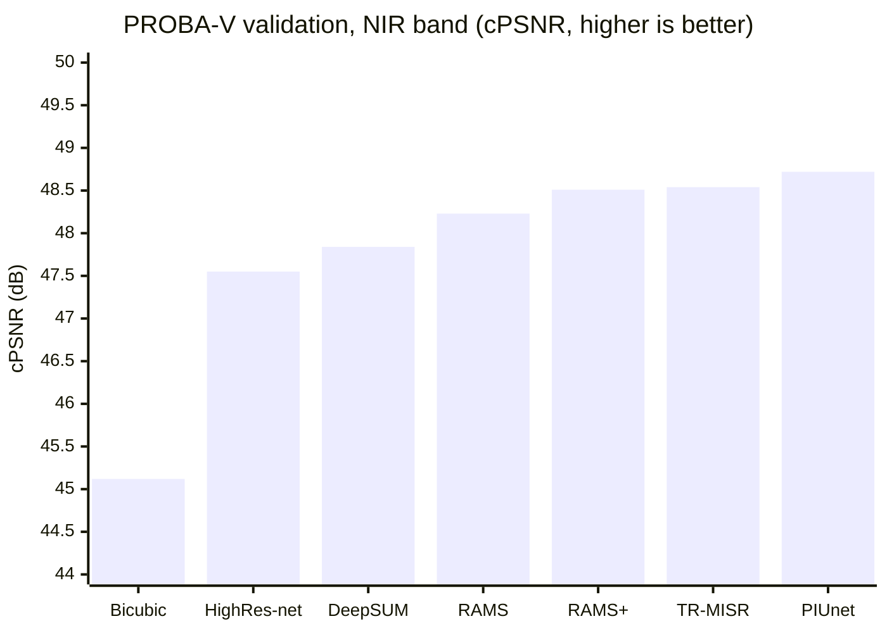
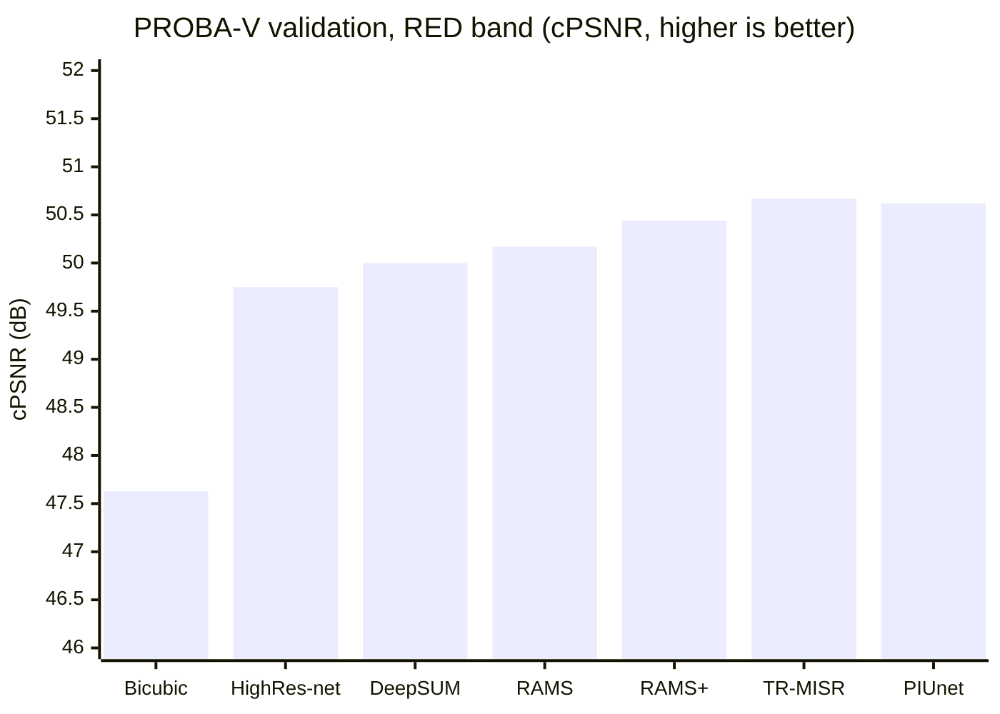
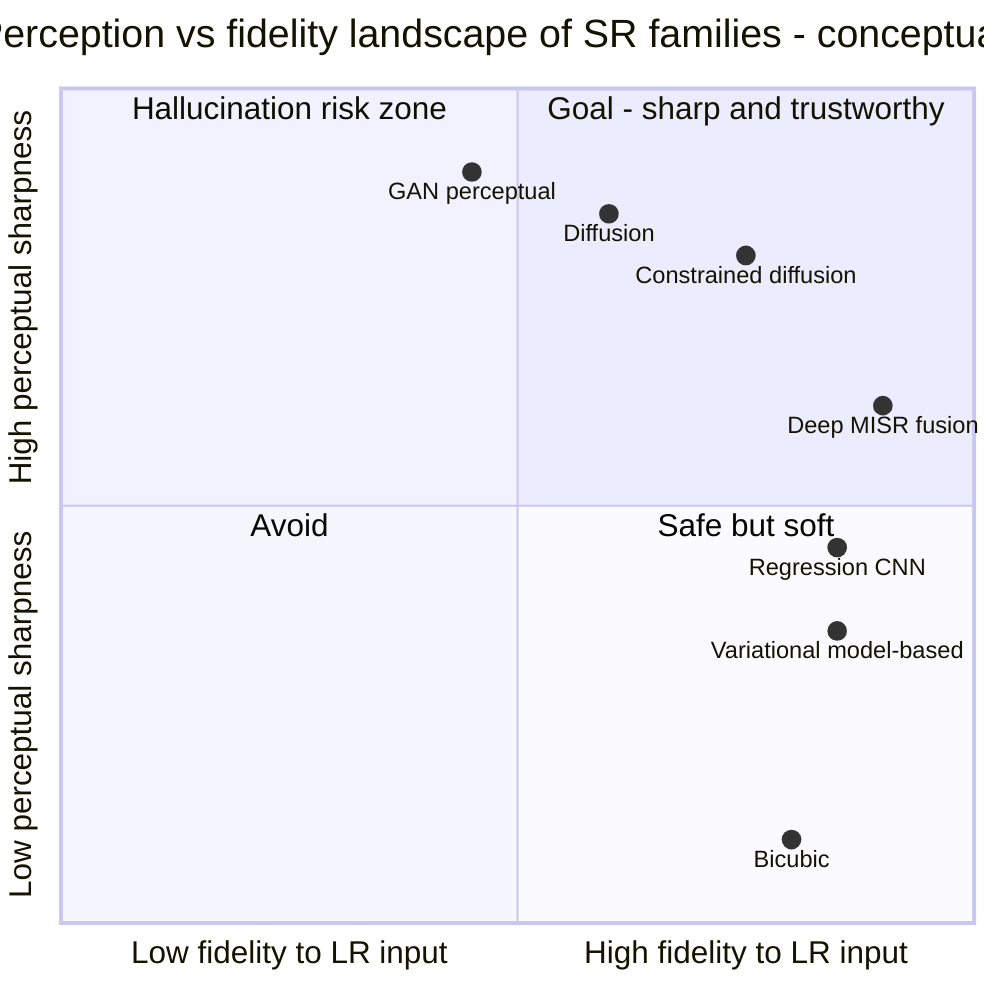
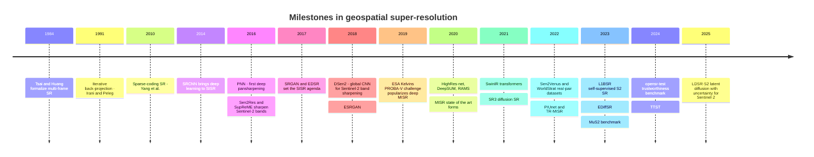

# Awesome Geospatial Super-Resolution 

> A curated list of algorithms, datasets, models, code, papers, and resources for **super-resolution (SR) of geospatial / Earth-observation data** — with a strong focus on optical satellite imagery such as **Sentinel-2**, but also covering multi-image SR, pansharpening, hyperspectral/thermal fusion, and SAR.

Super-resolution in Earth observation aims to recover a high-resolution (HR) image from one or more low-resolution (LR) acquisitions. In the geospatial context this is more than an aesthetic problem: sensor PSF/MTF, radiometric fidelity, geometric consistency, multi-spectral bands, revisit time, and the risk of *hallucinating* structures that do not exist on the ground all make it a distinct scientific field.

Maintained by [Bilel Khlaifia](https://github.com/khlaifiabilel). Contributions are welcome — see [Contributing](#contributing).

---

## Contents

- [Problem Taxonomy](#problem-taxonomy)
- [Algorithmic & Scientific Approaches](#algorithmic--scientific-approaches)
  - [Classical / Model-Based Methods](#classical--model-based-methods)
  - [Pansharpening & Multiresolution Band Sharpening](#pansharpening--multiresolution-band-sharpening)
  - [Deep Single-Image Super-Resolution (SISR)](#deep-single-image-super-resolution-sisr)
  - [Multi-Image / Multi-Temporal Super-Resolution (MISR)](#multi-image--multi-temporal-super-resolution-misr)
  - [Cross-Sensor & Reference-Based SR](#cross-sensor--reference-based-sr)
  - [Hyperspectral & Thermal Fusion](#hyperspectral--thermal-fusion)
  - [SAR Super-Resolution](#sar-super-resolution)
  - [Blind SR & Realistic Degradation Modeling](#blind-sr--realistic-degradation-modeling)
  - [Uncertainty, Hallucination & Trustworthiness](#uncertainty-hallucination--trustworthiness)
- [Datasets](#datasets)
  - [Sentinel-2 SR Training Datasets (real LR–HR pairs)](#sentinel-2-sr-training-datasets-real-lrhr-pairs)
  - [Multi-Image SR Datasets](#multi-image-sr-datasets)
  - [Generic Remote-Sensing Datasets Used for SR](#generic-remote-sensing-datasets-used-for-sr)
  - [Hyperspectral Fusion Datasets](#hyperspectral-fusion-datasets)
  - [High-Resolution Imagery Sources (for building pairs)](#high-resolution-imagery-sources-for-building-pairs)
- [Models & Code](#models--code)
  - [Sentinel-2 Specific Tools & Models](#sentinel-2-specific-tools--models)
  - [Multi-Image SR Codebases](#multi-image-sr-codebases)
  - [Remote-Sensing SISR Codebases](#remote-sensing-sisr-codebases)
  - [Pansharpening & Fusion Toolboxes](#pansharpening--fusion-toolboxes)
  - [General-Purpose SR Frameworks](#general-purpose-sr-frameworks)
  - [Operational / Commercial Products](#operational--commercial-products)
- [Evaluation & Benchmarking](#evaluation--benchmarking)
- [Benchmarks & Reported Results](#benchmarks--reported-results)
  - [Benchmark Suites at a Glance](#benchmark-suites-at-a-glance)
  - [PROBA-V MISR Results](#proba-v-misr-results)
  - [Reported Results on Synthetic RS SISR Benchmarks](#reported-results-on-synthetic-rs-sisr-benchmarks)
  - [Sentinel-2 Band-Sharpening Methods Compared](#sentinel-2-band-sharpening-methods-compared)
  - [Method-Family Trade-offs](#method-family-trade-offs)
  - [Metrics Cheat Sheet](#metrics-cheat-sheet)
  - [Milestone Timeline](#milestone-timeline)
- [Papers & References](#papers--references)
  - [Surveys & Reviews](#surveys--reviews)
  - [Foundational SISR Papers](#foundational-sisr-papers)
  - [Sentinel-2 & Remote-Sensing SR Papers](#sentinel-2--remote-sensing-sr-papers)
  - [Multi-Image SR Papers](#multi-image-sr-papers)
  - [Dataset & Benchmark Papers](#dataset--benchmark-papers)
  - [SR for Downstream Applications](#sr-for-downstream-applications)
- [Challenges & Competitions](#challenges--competitions)
- [Related Lists & Learning Resources](#related-lists--learning-resources)
- [Contributing](#contributing)
- [License](#license)

---

## Problem Taxonomy

| Setting | Input | Typical geospatial example |
|---|---|---|
| **SISR** (single-image SR) | 1 LR image | Sentinel-2 10 m RGB-NIR → 2.5 m |
| **MISR** (multi-image / multi-frame SR) | Several LR images of the same scene (different times / sub-pixel shifts) | PROBA-V 300 m → 100 m; Sentinel-2 revisit series → 5 m |
| **Pansharpening** | LR multispectral + HR panchromatic | WorldView / SPOT / Landsat MS + PAN |
| **Multiresolution band sharpening** | Bands of one sensor at different GSDs | Sentinel-2 20 m / 60 m bands → 10 m |
| **Cross-sensor fusion / SR** | LR sensor + HR sensor (as target or reference) | Sentinel-2 ↔ Venµs, SPOT, NAIP, PlanetScope |
| **Hyperspectral–multispectral fusion** | LR HSI + HR MSI | EnMAP / PRISMA + Sentinel-2 |
| **Thermal sharpening / downscaling** | LR thermal + HR reflective bands | Landsat TIR, ECOSTRESS LST |
| **SAR SR** | LR SAR amplitude / complex data | Sentinel-1 enhancement |

Sentinel-2 reminder: MSI has 13 bands at three native resolutions — **10 m** (B2, B3, B4, B8), **20 m** (B5, B6, B7, B8A, B11, B12), **60 m** (B1, B9, B10) — which is why both *band sharpening* (20/60 → 10 m) and *beyond-native SR* (10 m → 5/2.5/1 m) are active research problems.

---

## Algorithmic & Scientific Approaches

### Classical / Model-Based Methods

- **Interpolation** — nearest neighbor, bilinear, bicubic, Lanczos. Always report as baseline; no new information is created.
- **Frequency-domain MISR** — the original SR formulation from aliased multi-acquisitions (Tsai & Huang, 1984).
- **Reconstruction-based MISR** — model the imaging chain (warp + blur + decimation + noise) and invert it:
  - Shift-and-add on sub-pixel registered frames.
  - **Iterative Back-Projection (IBP)** (Irani & Peleg, 1991).
  - **POCS** — Projection Onto Convex Sets.
  - **MAP / Bayesian estimation** with priors: Tikhonov, Total Variation, Huber-MRF.
- **Example/learning-based (pre-deep-learning)**:
  - Neighbor embedding (Chang et al., 2004).
  - **Sparse coding / dictionary learning** (Yang et al., 2010).
  - Internal self-similarity / single-image "exemplar" SR (Glasner et al., 2009).
  - Anchored neighborhood regression (ANR, A+; Timofte et al., 2013–2014).
- **Geostatistical downscaling** — **ATPRK** (Area-To-Point Regression Kriging) applied to Sentinel-2 20 m → 10 m and MODIS/Landsat fusion (Q. Wang et al., 2016).
- **Spatio-temporal fusion of image pairs** — STARFM, ESTARFM, FSDAF: fuse frequent-coarse (MODIS) with sparse-fine (Landsat) time series; conceptually adjacent to SR and often combined with it.

### Pansharpening & Multiresolution Band Sharpening

Classical families (see Vivone et al. 2015/2021 critical comparisons):

- **Component Substitution (CS)** — IHS, Brovey, PCA, **Gram-Schmidt (GS/GSA)**, BDSD, PRACS.
- **Multi-Resolution Analysis (MRA)** — à-trous wavelet (ATWT), Laplacian pyramid, **MTF-matched Generalized Laplacian Pyramid (MTF-GLP)**, SFIM.
- **Variational / model-based (VO)** — P+XS, sparse-representation fusion, low-rank models.
- **Deep pansharpening** — PNN (Masi et al., 2016), PanNet, DiCNN, FusionNet, GAN-based (PSGAN), unsupervised/zero-shot variants; benchmarked in *Machine Learning in Pansharpening: A Benchmark* (DLPan-Toolbox).

Sentinel-2 has **no panchromatic band**, so dedicated *band sharpening* methods use the 10 m bands as spatial guides for the 20/60 m bands:

- **SupReME** — variational, subspace + regularization (Lanaras et al., 2017).
- **Sen2Res** — band-independent geometry / shared pixel composition model (Brodu, 2017); available as an ESA SNAP plugin.
- **S2Sharp** — reduced-rank variational sharpening (Ulfarsson et al., 2019).
- **DSen2** — deep CNN trained with Wald protocol (scale-invariance assumption) (Lanaras et al., 2018).
- **ATPRK** for S2 (Q. Wang et al., 2016).

### Deep Single-Image Super-Resolution (SISR)

Backbone families, all widely re-used in remote sensing:

- **CNN, pixel-wise losses** — SRCNN, FSRCNN, **ESPCN** (sub-pixel convolution), VDSR (residual learning), **EDSR/MDSR**, RDN, **RCAN** (channel attention), SAN, HAN. Sharp on PSNR, tend to be blurry perceptually.
- **Efficient CNNs** — CARN, IMDN, RLFN: important for processing at satellite-mission scale (CARN is the backbone of the CNES Sentinel-2 SR tool).
- **GAN / perceptual** — **SRGAN**, **ESRGAN**, Real-ESRGAN, BSRGAN: sharper textures, higher hallucination risk — a key trade-off for EO.
- **Transformers** — **SwinIR**, HAT, ART; remote-sensing-specific: TransENet, **TTST** (top-k token selective transformer), Swin2-MoSE (mixture-of-experts).
- **Diffusion models** — SR3 (iterative refinement), SRDiff, latent-diffusion upscalers (LDM/Stable Diffusion x4), ResShift; remote-sensing-specific: **EDiffSR**, **LDSR-S2 / opensr-model** (latent diffusion for Sentinel-2, ESA OpenSR).
- **Implicit neural representations / arbitrary-scale SR** — **LIIF**, LTE; remote-sensing: **FunSR** (continuous-scale RS SR). Attractive for geospatial data because target GSD becomes a continuous parameter.
- **Normalizing flows** — SRFlow: explicit likelihood, sample diversity.

### Multi-Image / Multi-Temporal Super-Resolution (MISR)

Exploits sub-pixel shifts across repeated acquisitions — physically grounded, lower hallucination risk than SISR, natural fit for high-revisit missions (PROBA-V, Sentinel-2, PlanetScope).

- **DeepSUM** (Molini et al., 2020) — joint registration + fusion CNN; winner of the ESA PROBA-V Kelvins challenge era.
- **HighRes-net** (Deudon et al., 2020) — recursive pairwise fusion against a shared reference + learned registration (ShiftNet) + registered loss.
- **RAMS** (Salvetti et al., 2020) — 3D convolutions + feature/temporal attention.
- **PIUnet** (Valsesia & Magli, 2021) — temporal permutation invariance + epistemic/aleatoric uncertainty estimation.
- **TR-MISR** (An et al., 2022) — transformer-based fusion of unregistered frames.
- **L1BSR** (Nguyen et al., 2023) — self-supervised ×2 SR of Sentinel-2 **L1B** data using detector-overlap redundancy; no external HR labels.
- **WorldStrat / MuS2-style S2 MISR** — multi-revisit Sentinel-2 → SPOT/WorldView targets.
- Classical baselines still relevant: shift-and-add, IBP, MAP-MRF (see above).

### Cross-Sensor & Reference-Based SR

Learning real (not simulated) degradations by pairing sensors:

- **Sentinel-2 → Venµs** (5 m, same-day near-identical viewing geometry): Sen2Venµs dataset.
- **Sentinel-2 → SPOT 6/7** (1.5 m): WorldStrat.
- **Sentinel-2 → NAIP aerial** (~1 m): S2-NAIP / SEN2NAIP, Satlas SR (ESRGAN at continental scale).
- **Landsat-8 → Sentinel-2** (30 m → 10 m, ×3): OLI2MSI.
- **Sentinel-2 → PlanetScope**: radiometrically harmonized pair training (Galar et al., 2020).
- Key scientific issues: co-registration error, temporal gap (land-cover change between LR and HR acquisition), radiometric/spectral response mismatch, PSF differences — motivates registration-aware losses, harmonization pre-processing, and degradation modeling.
- **Reference-based SR (RefSR)**: transfer texture from an HR reference of the same location acquired earlier / by another sensor.

### Hyperspectral & Thermal Fusion

- **HSI–MSI fusion** (e.g., EnMAP/PRISMA/AVIRIS + Sentinel-2/RGB):
  - Unmixing / matrix factorization: **CNMF** (Yokoya et al., 2012).
  - Variational / subspace: **HySure**, Bayesian sparse fusion (Wei et al.).
  - Deep: MHF-Net, SSR-NET, **HyperTransformer**, unsupervised autoencoder couplings.
- **Hyperspectral pansharpening** — review by Loncan et al. (2015).
- **Hyperspectral SISR** — 3D-CNNs, group convolutions, spectral-attention transformers (e.g., SSPSR).
- **Thermal sharpening / LST downscaling** — DisTrad (Kustas et al., 2003), **TsHARP** (Agam et al., 2007), random-forest and deep variants for Landsat TIR, MODIS LST, ECOSTRESS.

### SAR Super-Resolution

- Spectral extrapolation and bandwidth synthesis (classical radar signal processing).
- CNN/GAN SR on amplitude images, usually joint with **despeckling** (speckle breaks the additive-Gaussian assumptions of RGB SR).
- Cross-modal guidance: optical-guided SAR SR and SAR-to-optical translation (use with care — high hallucination risk).

### Blind SR & Realistic Degradation Modeling

The gap between bicubic-downsampled training data and real sensor physics is the main failure mode of naive RS SR:

- **Sensor PSF/MTF-based degradation** — simulate LR with the actual instrument MTF (standard in pansharpening; Wald protocol) instead of bicubic.
- **Kernel estimation** — KernelGAN, kernel-conditioned networks (SRMD, DAN).
- **Complex degradation pipelines** — BSRGAN, Real-ESRGAN (blur + noise + compression cascades).
- **Wald's protocol** (reduced-resolution training/validation): train at LR-of-LR scale, apply at native scale — the classic scale-transfer assumption used by DSen2 and most band-sharpening work.
- Noise, compression (JPEG2000 on some missions), orthorectification resampling — all should be represented in the degradation model.

### Uncertainty, Hallucination & Trustworthiness

- Aleatoric/epistemic uncertainty maps (PIUnet; Bayesian deep SR; deep ensembles; MC-dropout).
- Diffusion/flow sampling diversity as posterior exploration ("many plausible HR images per LR input").
- Hallucination measurement: consistency with the LR input vs. invention of structures — formalized by **opensr-test** (consistency / synthesis / correctness metrics).
- Task-based validation: does SR actually improve building detection, crop mapping, boat counting — or just look nicer? (see Shermeyer & Van Etten, 2019).
- Recommended practice: always publish per-pixel uncertainty or consistency diagnostics next to SR products used for decision-making.

---

## Datasets

### Sentinel-2 SR Training Datasets (real LR–HR pairs)

| Dataset | Pairing | Factor | Notes | Link |
|---|---|---|---|---|
| **Sen2Venµs** | Sentinel-2 L2A (10/20 m) → Venµs (5 m) | ×2 / ×4 | ~130k patches, 29 sites, same-day acquisitions, surface reflectance | [Paper/DOI](https://doi.org/10.3390/data7070096) |
| **WorldStrat** | Sentinel-2 (multi-revisit) → Airbus SPOT 6/7 (1.5 m) | ×4–×6 | ~10,000 km², globally stratified (incl. under-represented regions), SISR + MISR | [GitHub](https://github.com/worldstrat/worldstrat) · [arXiv](https://arxiv.org/abs/2207.06418) |
| **S2-NAIP** | Sentinel-2 time series → NAIP aerial (~1 m) | ×4–×8 | Continental US, used by AllenAI Satlas SR | [Hugging Face](https://huggingface.co/datasets/allenai/s2-naip) |
| **SEN2NAIP** (ESA OpenSR) | NAIP HR + harmonized synthetic Sentinel-2-like LR | ×4 | Degradation model calibrated to real S2; companion of opensr-test | [ESA OpenSR org](https://github.com/ESAOpenSR) |
| **OLI2MSI** | Landsat-8 OLI (30 m) → Sentinel-2 (10 m) | ×3 | Cross-sensor, real pairs | [GitHub](https://github.com/wjwjww/OLI2MSI) |
| **MuS2** | Sentinel-2 multi-image → WorldView-2 | ~×2.5–×4 | Benchmark for S2 MISR (Kowaleczko et al., *Scientific Data*, 2023) | search: "MuS2 benchmark Sentinel-2" |

### Multi-Image SR Datasets

| Dataset | Content | Link |
|---|---|---|
| **PROBA-V SR** (ESA Kelvins) | 300 m → 100 m, RED & NIR, ~1,450 scenes, multiple LR frames per scene, quality masks | [Kelvins challenge](https://kelvins.esa.int/proba-v-super-resolution/) |
| **WorldStrat** | 16 S2 revisits per SPOT target — usable for MISR | [GitHub](https://github.com/worldstrat/worldstrat) |
| **Sentinel-2 L1B detector overlaps** | Self-supervised MISR/SISR without HR labels (L1BSR) | [GitHub](https://github.com/centreborelli/L1BSR) |

### Generic Remote-Sensing Datasets Used for SR

LR is usually generated synthetically (bicubic or MTF-based downsampling) — fine for architecture research, insufficient alone for real-sensor deployment.

| Dataset | Content | Link |
|---|---|---|
| **UC Merced** | 21-class aerial scenes, 30 cm | [Homepage](http://weegee.vision.ucmerced.edu/datasets/landuse.html) |
| **AID** | 10k aerial scene images, 30 classes | [Homepage](https://captain-whu.github.io/AID/) |
| **NWPU-RESISC45** | 31.5k scene images, 45 classes | [TFDS entry](https://www.tensorflow.org/datasets/catalog/resisc45) |
| **DOTA** | Large aerial images with object boxes (SR + detection studies) | [Homepage](https://captain-whu.github.io/DOTA/) |
| **DIV2K** | Generic 2K natural images — standard SISR pre-training | [Homepage](https://data.vision.ee.ethz.ch/cvl/DIV2K/) |

### Hyperspectral Fusion Datasets

| Dataset | Content | Link |
|---|---|---|
| **CAVE** | 32 indoor HSI scenes, 31 bands (fusion benchmark) | [Homepage](https://www.cs.columbia.edu/CAVE/databases/multispectral/) |
| **Chikusei** | Airborne HSI, 128 bands, 2.5 m | [N. Yokoya downloads](https://naotoyokoya.com/Download.html) |
| **Pavia / Houston (GRSS)** | Urban HSI classics + IEEE GRSS Data Fusion Contest data | [GRSS DASE](http://dase.grss-ieee.org/) |

### High-Resolution Imagery Sources (for building pairs)

- **NAIP** — USDA aerial imagery of the US (~0.6–1 m), public domain.
- **Venµs** — CNES/ISA 5 m experimental mission, key S2 companion.
- **SpaceNet** — HR satellite imagery + labels: [spacenet.ai](https://spacenet.ai/)
- **xView** — 0.3 m WorldView-3 detection dataset: [xviewdataset.org](https://xviewdataset.org/)
- **Maxar Open Data** — event-driven HR releases: [maxar.com/open-data](https://www.maxar.com/open-data)
- **OpenAerialMap** — open aerial imagery: [openaerialmap.org](https://openaerialmap.org/)
- **Copernicus Data Space Ecosystem** — all Sentinel data: [dataspace.copernicus.eu](https://dataspace.copernicus.eu/)

---

## Models & Code

### Sentinel-2 Specific Tools & Models

| Tool / Model | Approach | Output | Link |
|---|---|---|---|
| **DSen2** | CNN band sharpening (Wald protocol) | 20/60 m bands → 10 m | [GitHub](https://github.com/lanha/DSen2) |
| **SupReME** | Variational subspace model | 20/60 m bands → 10 m | [GitHub](https://github.com/lanha/SupReME) |
| **Sen2Res** | Band-independent geometry model (SNAP plugin) | 20/60 m bands → 10 m | [Author page](https://nicolas.brodu.net/recherche/superres/) |
| **sentinel2_superresolution** (CNES) | CARN SISR trained on Sen2Venµs | 10/20 m bands → 5 m | [PyPI](https://pypi.org/project/sentinel2-superresolution/) |
| **Satlas Super-Resolution** (AllenAI) | ESRGAN trained on S2-NAIP time series | S2 → ~2.5 m (deployed globally) | [GitHub](https://github.com/allenai/satlas-super-resolution) |
| **ESA OpenSR / LDSR-S2 (opensr-model)** | Latent diffusion ×4 with trustworthiness focus | S2 10 m → 2.5 m | [GitHub org](https://github.com/ESAOpenSR) |
| **sr4rs** | GAN SISR for Sentinel-2 (OTB/TensorFlow integration) | S2 ×4 | [GitHub](https://github.com/remicres/sr4rs) |
| **L1BSR** | Self-supervised ×2 from L1B detector overlap | S2 L1B ×2 | [GitHub](https://github.com/centreborelli/L1BSR) |

### Multi-Image SR Codebases

| Model | Notes | Link |
|---|---|---|
| **HighRes-net** | Recursive fusion + ShiftNet registration (PROBA-V) | [GitHub](https://github.com/ElementAI/HighRes-net) |
| **DeepSUM** | Joint registration/fusion CNN (PROBA-V) | [GitHub](https://github.com/diegovalsesia/deepsum) |
| **RAMS** | 3D residual attention MISR | [GitHub](https://github.com/EscVM/RAMS) |
| **PIUnet** | Permutation-invariant MISR + uncertainty | [GitHub](https://github.com/diegovalsesia/piunet) |
| **TR-MISR** | Transformer fusion for MISR | [GitHub](https://github.com/Suanmd/TR-MISR) |
| **WorldStrat baselines** | SISR + MISR training pipelines on WorldStrat | [GitHub](https://github.com/worldstrat/worldstrat) |

### Remote-Sensing SISR Codebases

| Model | Notes | Link |
|---|---|---|
| **EDiffSR** | Efficient diffusion model for RS SR (TGRS 2023) | [GitHub](https://github.com/XY-boy/EDiffSR) |
| **TTST** | Top-k token selective transformer for RS SR | [GitHub](https://github.com/XY-boy/TTST) |
| **TransENet** | Transformer-enhanced RS SR | [GitHub](https://github.com/Shaosifan/TransENet) |
| **FunSR** | Continuous / arbitrary-scale RS SR via implicit functions | [GitHub](https://github.com/KyanChen/FunSR) |
| **Swin2-MoSE** | Swin V2 + mixture-of-experts for RS SR | [GitHub](https://github.com/IMPLabUniPr/swin2-mose) |

### Pansharpening & Fusion Toolboxes

| Toolbox | Notes | Link |
|---|---|---|
| **DLPan-Toolbox** | Code for "Machine Learning in Pansharpening: A Benchmark" (classical + DL) | [GitHub](https://github.com/liangjiandeng/DLPan-Toolbox) |
| **PanCollection** | Datasets + baselines for deep pansharpening | [GitHub](https://github.com/liangjiandeng/PanCollection) |
| **py_pansharpening** | Classical pansharpening algorithms in Python | [GitHub](https://github.com/codegaj/py_pansharpening) |
| **HyperTransformer** | Transformer HSI pansharpening | [GitHub](https://github.com/wgcban/HyperTransformer) |

### General-Purpose SR Frameworks

| Framework | Notes | Link |
|---|---|---|
| **BasicSR** | Reference PyTorch SR framework (EDSR, RCAN, ESRGAN, Real-ESRGAN, SwinIR...) | [GitHub](https://github.com/XPixelGroup/BasicSR) |
| **MMagic** (OpenMMLab) | SR / restoration / generation model zoo | [GitHub](https://github.com/open-mmlab/mmagic) |
| **KAIR** | Training code for USRNet, SwinIR, BSRGAN, DPIR... | [GitHub](https://github.com/cszn/KAIR) |
| **super-image** | Hugging-Face-style SISR library | [GitHub](https://github.com/eugenesiow/super-image) |
| **Real-ESRGAN** | Practical blind SR | [GitHub](https://github.com/xinntao/Real-ESRGAN) |
| **SwinIR** | Transformer restoration/SR | [GitHub](https://github.com/JingyunLiang/SwinIR) |
| **HAT** | Hybrid attention transformer SR (SOTA PSNR) | [GitHub](https://github.com/XPixelGroup/HAT) |
| **LIIF** | Continuous-scale SR | [GitHub](https://github.com/yinboc/liif) |
| **SR3 (unofficial)** | Diffusion SR via iterative refinement | [GitHub](https://github.com/Janspiry/Image-Super-Resolution-via-Iterative-Refinement) |
| **SRDiff** | Diffusion SISR | [GitHub](https://github.com/LeiaLi/SRDiff) |
| **Latent Diffusion** | Includes LDM-SR upscaler | [GitHub](https://github.com/CompVis/latent-diffusion) |

### Operational / Commercial Products

- **S2DR3** (Gamma Earth) — 10× SR of all Sentinel-2 bands to ~1 m: [gamma.earth](https://gamma.earth/)
- **Satlas Explorer** (AllenAI) — global super-resolved Sentinel-2 basemap from the Satlas SR model.
- Various basemap vendors apply proprietary SR/harmonization to Sentinel-2/PlanetScope mosaics — always check licensing and scientific validity before quantitative use.

---

## Evaluation & Benchmarking

**Full-reference (distortion) metrics**
- PSNR, SSIM, MS-SSIM — standard but insensitive to hallucination.
- **SAM** (Spectral Angle Mapper), **ERGAS**, SCC, UIQI/Q-index, **Q2n** — spectral/radiometric fidelity, essential for multispectral SR.
- **LPIPS**, DISTS, JLD — learned perceptual metrics ([LPIPS code](https://github.com/richzhang/PerceptualSimilarity), [JLD code](https://github.com/shreshthsaini/jld)).

**No-reference / distributional**
- QNR (pansharpening, full-resolution protocol), NIQE, BRISQUE.
- FID / KID for generative SR realism.

**Protocols specific to EO**
- **Wald's protocol** — validate at reduced resolution; assume scale transfer.
- Full-resolution (no-reference) validation — QNR-style consistency checks.
- **opensr-test** — dedicated Sentinel-2 SR benchmark measuring *consistency* (agreement with LR input), *synthesis* (high-frequency detail), and *correctness* (hallucination vs. real structures): [GitHub](https://github.com/ESAOpenSR/opensr-test)
- **Task-based evaluation** — measure downstream impact (detection mAP, segmentation IoU, area estimates) rather than image metrics alone.

**Metric libraries**
- [piq](https://github.com/photosynthesis-team/piq) · [IQA-PyTorch](https://github.com/chaofengc/IQA-PyTorch) · [opensr-test](https://github.com/ESAOpenSR/opensr-test)

**Practical guidance**
- Never evaluate a GAN/diffusion SR model with PSNR alone — report a perception metric *and* a consistency/hallucination diagnostic.
- Beware temporal gaps in cross-sensor test pairs: "errors" may be real land-cover change.
- Check geometric shifts before scoring: sub-pixel misregistration destroys PSNR/SSIM comparability (use shift-tolerant scoring as in the PROBA-V challenge).

---

## Benchmarks & Reported Results

> **A note on numbers.** All figures below are *as reported in the original papers* (or compiled in later comparison tables). Evaluation splits, registration handling, quality masks, and implementations differ subtly between papers — treat gaps smaller than ~0.2 dB as noise, and re-run the official code or [opensr-test](https://github.com/ESAOpenSR/opensr-test) before citing numbers in your own work. Charts are rendered with [Mermaid](https://mermaid.js.org/) directly by GitHub.

### Benchmark Suites at a Glance

| Benchmark | Task | LR → HR | Primary metrics | Where |
|---|---|---|---|---|
| **PROBA-V Kelvins** | MISR ×3 | 300 m → 100 m (RED, NIR) | cPSNR, cSSIM | [Kelvins](https://kelvins.esa.int/proba-v-super-resolution/) |
| **opensr-test** | Sentinel-2 SISR ×4 | S2 → NAIP-like / Venµs | Consistency, Synthesis, Correctness (+ LPIPS...) | [GitHub](https://github.com/ESAOpenSR/opensr-test) |
| **Sen2Venµs** | Sentinel-2 SISR ×2 / ×4 | S2 10/20 m → Venµs 5 m | RMSE, PSNR, SAM | [DOI](https://doi.org/10.3390/data7070096) |
| **WorldStrat** | SISR + MISR ×4+ | S2 → SPOT 6/7 (1.5 m) | PSNR, SSIM, LPIPS | [GitHub](https://github.com/worldstrat/worldstrat) |
| **MuS2** | Sentinel-2 MISR | S2 → WorldView-2 | cPSNR, SSIM, LPIPS | *Scientific Data*, 2023 |
| **OLI2MSI** | Cross-sensor SISR ×3 | Landsat-8 → S2 | PSNR, SSIM | [GitHub](https://github.com/wjwjww/OLI2MSI) |
| **UC Merced / AID SR splits** | Synthetic SISR ×2–×4 | Bicubic-degraded aerial scenes | PSNR, SSIM | [UC Merced](http://weegee.vision.ucmerced.edu/datasets/landuse.html) · [AID](https://captain-whu.github.io/AID/) |
| **Papers With Code** | Various SR leaderboards | — | — | [PWC](https://paperswithcode.com/task/image-super-resolution) |

The three evaluation axes of **opensr-test** (increasingly used as the reference protocol for Sentinel-2 SR):

| Axis | Question it answers | Failure it catches |
|---|---|---|
| **Consistency** | Does the SR image stay faithful to the LR input (reflectance, spectra, geometry)? | Radiometric drift, spatial shifts |
| **Synthesis** | Did the model actually add high-frequency detail? | Blurry "safe" outputs that only interpolate |
| **Correctness** | Is the added detail real (vs. the true HR reference)? | Hallucinated buildings, invented texture |

### PROBA-V MISR Results

The ESA Kelvins PROBA-V dataset remains the reference benchmark for deep MISR. Metric is **cPSNR** — a PSNR made tolerant to small geometric shifts (±3 px search) and global brightness bias, computed on clear pixels only. Values below are on the community validation split introduced with DeepSUM.

| Method | Year | Type | cPSNR NIR (dB) | cPSNR RED (dB) | Code |
|---|---|---|---|---|---|
| Bicubic (best single frame) | — | Interpolation | 45.12 | 47.63 | — |
| HighRes-net | 2020 | Deep MISR (recursive fusion) | 47.55 | 49.75 | [GitHub](https://github.com/ElementAI/HighRes-net) |
| DeepSUM | 2020 | Deep MISR (joint registration) | 47.84 | 50.00 | [GitHub](https://github.com/diegovalsesia/deepsum) |
| RAMS | 2020 | 3D residual attention | 48.23 | 50.17 | [GitHub](https://github.com/EscVM/RAMS) |
| RAMS+ (self-ensemble) | 2020 | 3D residual attention | 48.51 | 50.44 | [GitHub](https://github.com/EscVM/RAMS) |
| TR-MISR | 2022 | Transformer fusion | 48.54 | 50.67 | [GitHub](https://github.com/Suanmd/TR-MISR) |
| PIUnet | 2022 | Permutation-invariant + uncertainty | 48.72 | 50.62 | [GitHub](https://github.com/diegovalsesia/piunet) |

Takeaway: fusing ~9–16 real revisits buys **+3 to +3.6 dB** over single-image interpolation with essentially no hallucination — the physics of sub-pixel sampling is the most trustworthy source of extra resolution.

### Reported Results on Synthetic RS SISR Benchmarks

Approximate ×4 PSNR on **UC Merced** (bicubic degradation), compiled from the TransENet and TTST comparison tables (values rounded, marked `~` on purpose — see disclaimer above):

| Method | Year | Type | PSNR ×4 (dB) |
|---|---|---|---|
| SRCNN | 2014 | CNN | ~26.8 |
| LGCNet | 2017 | CNN (RS-specific) | ~26.9 |
| DCM | 2019 | CNN (RS-specific) | ~27.2 |
| HSENet | 2021 | Hybrid attention | ~27.7 |
| TransENet | 2022 | Transformer | ~27.8 |
| TTST | 2024 | Selective transformer | ~28.0 |

Two structural caveats: (1) bicubic-degraded benchmarks reward blur-optimal regression and transfer poorly to real sensor degradations; (2) ~1 dB of progress over a decade on this benchmark contrasts with the much larger practical gains from better degradation modeling and real LR–HR pairs (Sen2Venµs, S2-NAIP, WorldStrat).

### Sentinel-2 Band-Sharpening Methods Compared

Qualitative comparison of the main 20 m / 60 m → 10 m methods (no single agreed numeric benchmark exists; DSen2 and S2Sharp papers each report reduced-resolution RMSE/SRE comparisons on Wald-protocol data):

| Method | Type | 20→10 m | 60→10 m | Training needed | Speed | Code |
|---|---|---|---|---|---|---|
| ATPRK | Geostatistical (kriging) | Yes | Not typical | No | Fast | Limited |
| Sen2Res | Per-image geometric model | Yes | Yes | No (per-image optimization) | Slow | [SNAP plugin](https://nicolas.brodu.net/recherche/superres/) |
| SupReME | Variational subspace | Yes | Yes | No | Medium | [GitHub](https://github.com/lanha/SupReME) |
| S2Sharp | Variational reduced-rank | Yes | Yes | No | Medium | MATLAB |
| DSen2 | CNN (Wald protocol) | Yes | Yes | Pre-trained, globally applicable | Fast (GPU) | [GitHub](https://github.com/lanha/DSen2) |

Reported ordering in the DSen2 and S2Sharp papers is consistent: **DSen2 ≥ S2Sharp ≈ SupReME > Sen2Res > ATPRK > duplication/bicubic** on reduced-resolution RMSE — with the usual caveat that CNN advantages shrink out-of-distribution (unseen biomes/seasons).

### Method-Family Trade-offs

| Family | Examples | Pixel fidelity | Perceptual sharpness | Hallucination risk | Uncertainty output | Cost |
|---|---|---|---|---|---|---|
| Interpolation | Bicubic, Lanczos | Baseline | Very low | None | — | Negligible |
| Variational / model-based | SupReME, S2Sharp | High (within sensor) | Low–medium | Very low | Partial | CPU, minutes |
| Regression CNN (L1/L2) | EDSR, RCAN, DSen2, CARN | Highest on-distribution | Medium | Low–medium | No | GPU, ms–s |
| GAN / perceptual | ESRGAN, Satlas SR, sr4rs | Lower | High | **High** | No | GPU, ms–s |
| Transformer (L1) | SwinIR, HAT, TTST | Highest | Medium | Low–medium | No | GPU, heavier |
| Diffusion | SR3, EDiffSR, LDSR-S2 | Medium | High | Medium (measurable via sampling) | **Yes** (sample spread) | GPU, multi-step |
| Implicit / arbitrary-scale | LIIF, FunSR | Medium–high | Medium | Low–medium | No | Flexible |
| Deep MISR | HighRes-net → PIUnet | High (real sub-pixel info) | Medium–high | **Lowest** of learned methods | PIUnet: yes | Needs revisits |

### Metrics Cheat Sheet

| Metric | Type | Measures | Better | Watch out |
|---|---|---|---|---|
| PSNR | Full-reference | Pixel-wise error | Higher | Rewards blur; misregistration-sensitive |
| cPSNR | Full-reference | Shift/bias-tolerant PSNR | Higher | PROBA-V protocol; ±3 px search |
| SSIM / MS-SSIM | Full-reference | Structural similarity | Higher | Same blur bias, milder |
| LPIPS | Learned perceptual | Deep-feature distance | Lower | Trained on natural RGB, not multispectral |
| DISTS | Learned perceptual | Structure + texture | Lower | Same domain caveat |
| JLD | Learned perceptual | DINOv2 features projected on a Jacobian lens | Lower | Needs a reference image; both images same size |
| SAM | Spectral | Angle between spectral vectors | Lower | Blind to global intensity scaling |
| ERGAS | Spectral-radiometric | Normalized band-wise RMSE | Lower | Scale-factor dependent |
| SCC | Spatial | Correlation of high-pass detail | Higher | Needs good co-registration |
| Q4 / Q2n | Full-reference (MS) | Hypercomplex quality index | Higher | Pansharpening standard |
| QNR (Dλ, Ds) | No-reference | Spectral + spatial distortion | QNR higher; Dλ, Ds lower | Full-resolution pansharpening protocol |
| NIQE / BRISQUE | No-reference | Natural-image statistics | Lower | Not calibrated for EO imagery |
| FID / KID | Distributional | Realism of an output *set* | Lower | Says nothing about a single image; hallucination-blind |
| Task metrics (mAP, IoU...) | Downstream | Real utility of SR | Higher | The final arbiter for applications |

### Milestone Timeline

---

## Papers & References

### Surveys & Reviews

- Wang, Bayram & Sertel, *A comprehensive review on deep learning based remote sensing image super-resolution methods*, **Earth-Science Reviews**, 2022. [DOI](https://doi.org/10.1016/j.earscirev.2022.104110)
- Sdraka et al., *Deep Learning for Downscaling Remote Sensing Images: Fusion and Super-Resolution*, **IEEE Geoscience and Remote Sensing Magazine**, 2022.
- Wang, Chen & Hoi, *Deep Learning for Image Super-Resolution: A Survey*, **IEEE TPAMI**, 2020. [arXiv](https://arxiv.org/abs/1902.06068)
- Tsagkatakis et al., *Survey of Deep-Learning Approaches for Remote Sensing Observation Enhancement*, **Sensors**, 2019. [DOI](https://doi.org/10.3390/s19183929)
- Fernandez-Beltran et al., *Single-frame super-resolution in remote sensing: a practical overview*, **International Journal of Remote Sensing**, 2017.
- Vivone et al., *A Critical Comparison Among Pansharpening Algorithms*, **IEEE TGRS**, 2015. [DOI](https://doi.org/10.1109/TGRS.2014.2361734)
- Vivone et al., *A New Benchmark Based on Recent Advances in Multispectral Pansharpening*, **IEEE GRSM**, 2021.
- Deng et al., *Machine Learning in Pansharpening: A Benchmark, in-depth Survey, and Toolbox*, **IEEE GRSM**, 2022. [Code](https://github.com/liangjiandeng/DLPan-Toolbox)
- Yokoya, Grohnfeldt & Chanussot, *Hyperspectral and Multispectral Data Fusion: A comparative review*, **IEEE GRSM**, 2017.
- Loncan et al., *Hyperspectral Pansharpening: A Review*, **IEEE GRSM**, 2015.
- Liu et al., *Blind Image Super-Resolution: A Survey and Beyond*, **IEEE TPAMI**, 2022. [arXiv](https://arxiv.org/abs/2107.03055)

### Foundational SISR Papers

- **SRCNN** — Dong et al., *Image Super-Resolution Using Deep Convolutional Networks*, 2014–2015. [arXiv](https://arxiv.org/abs/1501.00092)
- **ESPCN** — Shi et al., *Real-Time Single Image and Video Super-Resolution Using an Efficient Sub-Pixel CNN*, CVPR 2016. [arXiv](https://arxiv.org/abs/1609.05158)
- **VDSR** — Kim et al., *Accurate Image Super-Resolution Using Very Deep Convolutional Networks*, CVPR 2016. [arXiv](https://arxiv.org/abs/1511.04587)
- **EDSR** — Lim et al., *Enhanced Deep Residual Networks for Single Image Super-Resolution*, CVPRW 2017. [arXiv](https://arxiv.org/abs/1707.02921)
- **RCAN** — Zhang et al., *Image Super-Resolution Using Very Deep Residual Channel Attention Networks*, ECCV 2018. [arXiv](https://arxiv.org/abs/1807.02758)
- **SRGAN** — Ledig et al., *Photo-Realistic Single Image Super-Resolution Using a GAN*, CVPR 2017. [arXiv](https://arxiv.org/abs/1609.04802)
- **ESRGAN** — Wang et al., ECCVW 2018. [arXiv](https://arxiv.org/abs/1809.00219)
- **Real-ESRGAN** — Wang et al., ICCVW 2021. [arXiv](https://arxiv.org/abs/2107.10833)
- **SwinIR** — Liang et al., ICCVW 2021. [arXiv](https://arxiv.org/abs/2108.10257)
- **HAT** — Chen et al., CVPR 2023. [arXiv](https://arxiv.org/abs/2205.04437)
- **SR3** — Saharia et al., *Image Super-Resolution via Iterative Refinement*, IEEE TPAMI 2022. [arXiv](https://arxiv.org/abs/2104.07636)
- **SRDiff** — Li et al., *SRDiff: Single image super-resolution with diffusion probabilistic models*, Neurocomputing 2022. [arXiv](https://arxiv.org/abs/2104.14951)
- **LDM** — Rombach et al., *High-Resolution Image Synthesis with Latent Diffusion Models* (incl. LDM-SR), CVPR 2022. [arXiv](https://arxiv.org/abs/2112.10752)
- **LIIF** — Chen et al., *Learning Continuous Image Representation with Local Implicit Image Function*, CVPR 2021. [arXiv](https://arxiv.org/abs/2012.09161)

### Sentinel-2 & Remote-Sensing SR Papers

- Lanaras et al., *Super-resolution of Sentinel-2 images: Learning a globally applicable deep neural network* (**DSen2**), **ISPRS Journal of Photogrammetry and Remote Sensing**, 2018. [arXiv](https://arxiv.org/abs/1803.04271)
- Lanaras et al., *Super-Resolution of Multispectral Multiresolution Images From a Single Sensor* (**SupReME**), CVPRW 2017.
- Brodu, *Super-Resolving Multiresolution Images With Band-Independent Geometry of Multispectral Pixels* (**Sen2Res**), **IEEE TGRS**, 2017. [arXiv](https://arxiv.org/abs/1609.07986)
- Ulfarsson et al., *Sentinel-2 Sharpening Using a Reduced-Rank Method* (**S2Sharp**), **IEEE TGRS**, 2019.
- Q. Wang et al., *Fusion of Sentinel-2 images* (ATPRK band sharpening), **Remote Sensing of Environment**, 2016.
- Masi et al., *Pansharpening by Convolutional Neural Networks* (**PNN**), **Remote Sensing**, 2016.
- Galar et al., *Learning Super-Resolution for Sentinel-2 Images with Real Ground Truth Data from a Reference Satellite*, **ISPRS Annals**, 2020.
- Salgueiro et al., *Super-Resolution of Sentinel-2 Imagery Using Generative Adversarial Networks*, **Remote Sensing**, 2020.
- Xiao et al., *EDiffSR: An Efficient Diffusion Probabilistic Model for Remote Sensing Image Super-Resolution*, **IEEE TGRS**, 2023. [Code](https://github.com/XY-boy/EDiffSR)
- Xiao et al., *TTST: A Top-k Token Selective Transformer for Remote Sensing Image Super-Resolution*, **IEEE TIP**, 2024. [Code](https://github.com/XY-boy/TTST)
- Lei et al., *Transformer-Based Multistage Enhancement for Remote Sensing Image Super-Resolution* (**TransENet**), **IEEE TGRS**, 2022. [Code](https://github.com/Shaosifan/TransENet)
- Chen et al., *Continuous Remote Sensing Image Super-Resolution based on Context Interaction in Implicit Function Space* (**FunSR**), **IEEE TGRS**, 2023. [Code](https://github.com/KyanChen/FunSR)
- Donike et al., *Trustworthy Super-Resolution of Multispectral Sentinel-2 Imagery with Latent Diffusion* (**LDSR-S2**, ESA OpenSR), **IEEE JSTARS**, 2025. [Code](https://github.com/ESAOpenSR)
- Nguyen et al., *L1BSR: Exploiting Detector Overlap for Self-Supervised Single-Image Super-Resolution of Sentinel-2 L1B Imagery*, CVPRW (EarthVision) 2023. [Code](https://github.com/centreborelli/L1BSR)

### Multi-Image SR Papers

- Tsai & Huang, *Multiframe image restoration and registration*, 1984 — the origin of MISR.
- Irani & Peleg, *Improving resolution by image registration* (IBP), 1991.
- Märtens et al., *Super-resolution of PROBA-V images using convolutional neural networks*, **Astrodynamics**, 2019. [arXiv](https://arxiv.org/abs/1907.01821)
- Molini et al., *DeepSUM: Deep Neural Network for Super-Resolution of Unregistered Multitemporal Images*, **IEEE TGRS**, 2020. [arXiv](https://arxiv.org/abs/1907.06490)
- Deudon et al., *HighRes-net: Recursive Fusion for Multi-Frame Super-Resolution of Satellite Imagery*, 2020. [arXiv](https://arxiv.org/abs/2002.06460)
- Salvetti et al., *Multi-Image Super Resolution of Remotely Sensed Images Using Residual Attention Deep Neural Networks* (**RAMS**), **Remote Sensing**, 2020. [Code](https://github.com/EscVM/RAMS)
- Valsesia & Magli, *Permutation Invariance and Uncertainty in Multitemporal Image Super-Resolution* (**PIUnet**), **IEEE TGRS**, 2022. [arXiv](https://arxiv.org/abs/2105.12409)
- An et al., *TR-MISR: Multiimage Super-Resolution Based on Feature Fusion With Transformers*, **IEEE JSTARS**, 2022. [Code](https://github.com/Suanmd/TR-MISR)

### Dataset & Benchmark Papers

- Michel et al., *SEN2VENµS, a Dataset for the Training of Sentinel-2 Super-Resolution Algorithms*, **Data**, 2022. [DOI](https://doi.org/10.3390/data7070096)
- Cornebise, Oršolić & Kalaitzis, *Open High-Resolution Satellite Imagery: The WorldStrat Dataset — With Application to Super-Resolution*, **NeurIPS Datasets & Benchmarks**, 2022. [arXiv](https://arxiv.org/abs/2207.06418)
- Kowaleczko et al., *MuS2: A Benchmark for Sentinel-2 Multi-Image Super-Resolution*, **Scientific Data**, 2023.
- Aybar et al., *A Comprehensive Benchmark for Optical Remote Sensing Image Super-Resolution* (**opensr-test**), **IEEE GRSL**, 2024. [Code](https://github.com/ESAOpenSR/opensr-test)
- Kelvins PROBA-V SR challenge description & post-mortem — [kelvins.esa.int](https://kelvins.esa.int/proba-v-super-resolution/)

### SR for Downstream Applications

- Shermeyer & Van Etten, *The Effects of Super-Resolution on Object Detection Performance in Satellite Imagery*, CVPRW 2019. [arXiv](https://arxiv.org/abs/1812.04098)
- SR as pre-processing for: building footprint extraction, agricultural parcel delineation, tree/crop counting, small-object (vehicle, vessel) detection, burned-area and flood mapping — search each with "super-resolution" for a rich applied literature.
- Caution: several studies show task gains saturate or reverse when SR hallucinates; always ablate against LR baselines.

---

## Challenges & Competitions

- **PROBA-V Super-Resolution** — ESA Advanced Concepts Team, Kelvins platform (2019). The reference MISR competition; data still available. [Link](https://kelvins.esa.int/proba-v-super-resolution/)
- **NTIRE** (CVPR workshop) — annual SR/restoration challenges; tracks on real-world SR, burst SR, and stereo SR are highly relevant. [NTIRE 2024](https://cvlai.net/ntire/2024/)
- **AI4EO** initiatives — ESA Φ-lab-linked challenges on EO enhancement. [ai4eo.eu](https://ai4eo.eu/)
- **IEEE GRSS Data Fusion Contest** — several editions on resolution enhancement / multimodal fusion. [GRSS](https://www.grss-ieee.org/)

## Related Lists & Learning Resources

- **satellite-image-deep-learning / techniques** — the reference list for DL on satellite imagery, includes an SR section: [GitHub](https://github.com/satellite-image-deep-learning/techniques)
- **Awesome Super-Resolution** (generic, very complete paper tracker): [GitHub](https://github.com/ChaofWang/Awesome-Super-Resolution)
- **ESA OpenSR project** — trustworthy SR for Sentinel-2 (models, datasets, evaluation): [GitHub org](https://github.com/ESAOpenSR)
- **Papers With Code — Image Super-Resolution** leaderboard: [paperswithcode.com](https://paperswithcode.com/task/image-super-resolution)
- **BasicSR docs & model zoo** — practical entry point for training your own SR models: [GitHub](https://github.com/XPixelGroup/BasicSR)

---

## Contributing

Contributions are very welcome! Please:

1. Fork the repo and add your entry in the right section (keep tables/formats consistent).
2. Prefer entries with **public code or data**; include the paper link (DOI/arXiv) when available.
3. One pull request per addition if possible, with a one-line justification.

See [CONTRIBUTING.md](CONTRIBUTING.md) for details.

## License

To the extent possible under law, the maintainers have waived all copyright and related rights to this work (CC0 1.0).
